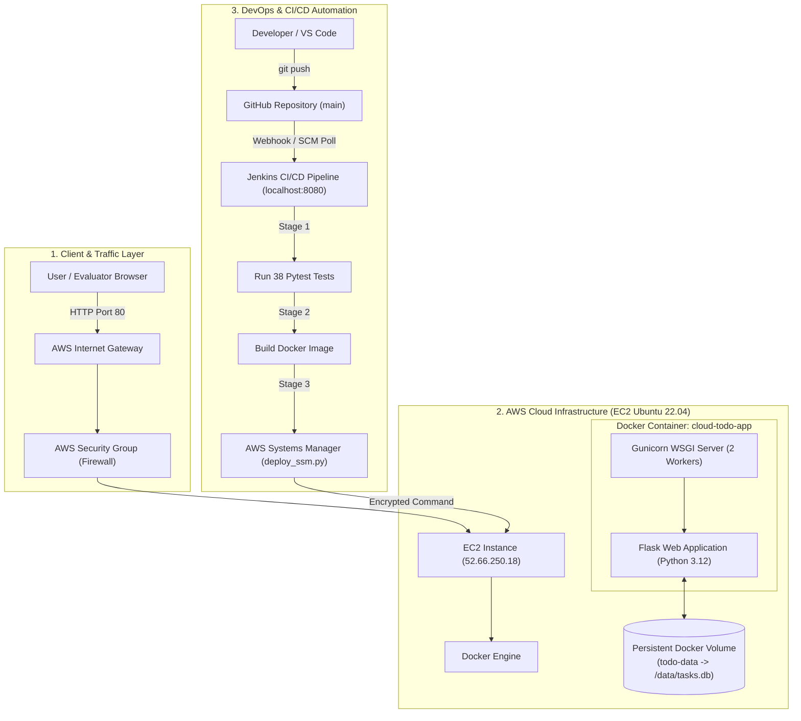

# 🚀 Cloud To-Do Project: Complete Step-by-Step Architecture & Demo Guide

> **Target Audience:** Anyone presenting or evaluating this project — written specifically for someone with **zero prior knowledge** of this codebase who needs to deliver an impressive, confident, A-grade live demonstration to a professor, evaluator, or interviewer.

---

## 📑 Table of Contents
1. [Executive Summary (What is this project?)](#1-executive-summary)
2. [Quick Reference Sheet (URLs, IPs, Credentials)](#2-quick-reference-sheet)
3. [Architecture Explained Simply (The Big Picture)](#3-architecture-explained-simply)
4. [Step-by-Step Technical Journey (What Was Built & Why)](#4-step-by-step-technical-journey)
   - [Step 1: The Web Application & API](#step-1-the-web-application--api)
   - [Step 2: Automated Testing Suite (Pytest)](#step-2-automated-testing-suite-pytest)
   - [Step 3: Containerization (Docker & Docker Compose)](#step-3-containerization-docker--docker-compose)
   - [Step 4: Infrastructure as Code (Terraform & AWS EC2)](#step-4-infrastructure-as-code-terraform--aws-ec2)
   - [Step 5: Zero-Trust Cloud Deployment (AWS SSM)](#step-5-zero-trust-cloud-deployment-aws-ssm)
   - [Step 6: Version Control (Git & GitHub)](#step-6-version-control-git--github)
   - [Step 7: Automated CI/CD Pipeline (Jenkins)](#step-7-automated-cicd-pipeline-jenkins)
5. [Word-for-Word Live Demo Script (Step-by-Step Action Plan)](#5-word-for-word-live-demo-script)
   - [Phase 1: Presenting the Live Cloud Web App](#phase-1-presenting-the-live-cloud-web-app-2-mins)
   - [Phase 2: Demonstrating the REST API & Health Probes](#phase-2-demonstrating-the-rest-api--health-probes-1-min)
   - [Phase 3: Demonstrating the Jenkins CI/CD Pipeline](#phase-3-demonstrating-the-jenkins-cicd-pipeline-2-mins)
   - [Phase 4: Showing the Source Code & DevOps Configs](#phase-4-showing-the-source-code--devops-configs-1-min)
6. [30-Second Elevator Pitch (What to Say Right at the Start)](#6-30-second-elevator-pitch)
7. [Viva & Professor Q&A (Likely Questions & Exact Answers)](#7-viva--professor-qa)
8. [Troubleshooting Guide (Crucial for Live Demos)](#8-troubleshooting-guide)

---

## 1. Executive Summary

### What is this project?
On the surface, it is a clean, modern **Cloud To-Do Web Application** that lets users manage tasks with priority, completion status, and responsive filters.

**However, the real engineering achievement is what is happening behind the scenes (DevOps & Cloud Infrastructure):**
Instead of just running a script on a local computer, this project demonstrates an **industry-standard enterprise cloud deployment pipeline**:
1. **Automated Testing:** 38 automated test cases run before any code can be built.
2. **Containerization:** The app is packaged into an isolated, lightweight **Docker** container running as a secure, non-root user.
3. **Infrastructure as Code (IaC):** The virtual server and networking in **AWS** were created deterministically using **Terraform**.
4. **Zero-Trust Deployment:** The server is updated remotely via **AWS Systems Manager (SSM)**, eliminating the security hazard of circulating open SSH private keys (`.pem`).
5. **Continuous Integration & Continuous Deployment (CI/CD):** A **Jenkins** declarative pipeline automatically pulls new commits from **GitHub**, tests them, builds the container, and deploys it live to AWS in under 2 minutes.

---

## 2. Quick Reference Sheet

Keep these links bookmarked or open in browser tabs before your demo starts:

| Item | Address / Value | Notes |
|---|---|---|
| **Live Web App URL** | **`http://52.66.250.18`** | ⚠️ Must use **`http://`**, NOT `https://` |
| **Health Check API** | **`http://52.66.250.18/api/health`** | Returns `{"database":true,"status":"healthy"}` |
| **Tasks REST API** | **`http://52.66.250.18/api/tasks`** | Returns live JSON list of tasks from SQLite |
| **GitHub Repository** | **[https://github.com/himanibhammar/cloud-todo](https://github.com/himanibhammar/cloud-todo)** | Public repo with full source code & CI/CD |
| **Jenkins Dashboard** | **`http://localhost:8080/job/cloud-todo-pipeline/`** | Local Jenkins CI/CD pipeline |
| **AWS Region** | `ap-south-1` (Mumbai) | AWS Cloud Data Center |
| **EC2 Instance ID** | `i-0b8e69504db4888f5` | `t3.micro` Ubuntu 22.04 LTS |
| **Web Server Port** | `80` (HTTP) | Standard web port open to world |

---

## 3. Architecture Explained Simply

Here is the high-level flow of how user traffic and automated code updates flow:



### Component Breakdown (Analogies for Non-Technical Understanding):
1. **Flask (Python Backend):** The restaurant kitchen. It takes task orders (create, update, delete) and processes them.
2. **Gunicorn:** The head waiter. Flask's built-in development server is weak; Gunicorn is a production-grade WSGI server that handles multiple simultaneous requests concurrently.
3. **SQLite & Docker Volume:** The filing cabinet. Tasks are saved in an SQLite database file. Docker volumes ensure that even if the container is destroyed or upgraded, the tasks remain permanently saved on the disk.
4. **Docker:** The shipping container. It bundles Python, all libraries, and the code so it runs identically on any operating system without *"it worked on my machine"* excuses.
5. **AWS EC2:** The physical building. A virtual computer hosted in Amazon's data center in Mumbai that stays running 24/7.
6. **Terraform:** The blueprint and construction crew. Instead of clicking buttons in the AWS console, code defines the server size, security firewall, and storage.
7. **AWS Systems Manager (SSM):** The secure satellite link. Instead of leaving port 22 open with passwords or `.pem` keys that could get stolen, AWS SSM executes deployment commands securely through Amazon's encrypted backbone.
8. **Jenkins:** The factory robot. The moment you push code to GitHub, Jenkins automatically tests the code, builds the container, and deploys it without human intervention.

---

## 4. Step-by-Step Technical Journey

### Step 1: The Web Application & API
- **Location:** `app/routes.py`, `app/database.py`, `app/static/`
- **What was built:**
  - REST API with 5 endpoints:
    - `GET /api/health`: Liveness probe that verifies database connectivity.
    - `GET /api/tasks`: Fetches all tasks ordered newest first.
    - `POST /api/tasks`: Validates input and creates a new task.
    - `PATCH /api/tasks/<id>`: Updates completion status, title, or description.
    - `DELETE /api/tasks/<id>`: Removes a task from SQLite.
  - A responsive, aesthetic frontend built with Vanilla HTML5, CSS3, and modern JavaScript (no bulky frontend frameworks needed).

### Step 2: Automated Testing Suite (Pytest)
- **Location:** `tests/test_api.py`, `tests/conftest.py`
- **What was built:**
  - 38 automated test cases testing:
    - Normal flows (task creation, updates, deletes).
    - Validation rules (rejecting empty titles, overlong text, invalid JSON).
    - Edge cases (404 errors, 405 Method Not Allowed, DB connectivity).
  - All 38 tests pass in ~1.4 seconds.

### Step 3: Containerization (Docker & Docker Compose)
- **Location:** `Dockerfile`, `docker-compose.yml`
- **What was built:**
  - Multi-stage Docker build starting from `python:3.12-slim`.
  - Created a dedicated user `appuser` (UID 1001) in group `appgroup`. The application runs strictly as non-root for security.
  - Exposes port `5000` internally, mapped to port `80` externally.
  - Mounted persistent volume: `todo-data:/data`.
  - Configured container health check: checks `/api/health` every 30s.

### Step 4: Infrastructure as Code (Terraform & AWS EC2)
- **Location:** `terraform/main.tf`, `terraform/variables.tf`, `terraform/outputs.tf`
- **What was built:**
  - Automated provisioning of an AWS `t3.micro` EC2 instance in `ap-south-1` running Ubuntu 22.04 LTS.
  - Security group (`cloud-todo-sg`):
    - Port 80 (HTTP): Open to `0.0.0.0/0` so any evaluator or friend can access it.
    - Port 22 (SSH): Restricted to trusted IP.
  - Egress rules: Full outbound internet connectivity for updates and package downloads.

### Step 5: Zero-Trust Cloud Deployment (AWS SSM)
- **Location:** `deploy_ssm.py`
- **Why this was done:**
  - Traditional deployments use SSH with `.pem` private keys. If a key is lost or placed on the wrong computer, security is compromised.
  - Instead, an **AWS IAM Role** (`cloud-todo-ssm-role`) with policy `AmazonSSMManagedInstanceCore` was attached to the EC2 instance.
  - The deployment script (`deploy_ssm.py`) talks to the **AWS SSM Agent** natively over HTTPS. It transfers the application files, triggers Docker build remotely, and starts the container with zero open SSH ports needed.

### Step 6: Version Control (Git & GitHub)
- **Repository:** `https://github.com/himanibhammar/cloud-todo`
- **What was built:**
  - Proper `.gitignore` ensuring zero secrets (`.pem` keys, `terraform.tfstate`, `.env` files, `.tfvars`) ever touch GitHub.
  - Clean git history with descriptive commit messages tracking each feature and deployment fix.

### Step 7: Automated CI/CD Pipeline (Jenkins)
- **Location:** `Jenkinsfile`
- **What was built:**
  - Declarative Jenkins pipeline tailored for Windows environment:
    - **Stage 1: Checkout** (Pulls latest Git commit)
    - **Stage 2: Test** (Executes `python -m pytest tests/ -v`)
    - **Stage 3: Docker Build** (Builds `cloud-todo:latest` on Docker Desktop)
    - **Stage 4: Deploy to EC2** (Runs `python deploy_ssm.py` to trigger remote EC2 deployment)
    - **Stage 5: Verify Deployment** (Curls `http://52.66.250.18/api/health` and verifies 200 OK)
  - Pipeline verified and passing: **`Finished: SUCCESS`**.

---

## 5. Word-for-Word Live Demo Script

Follow these 4 phases in order during your demo.

---

### Phase 1: Presenting the Live Cloud Web App (2 mins)

1. **Open your browser and navigate to:**
   👉 **`http://52.66.250.18`** *(Ensure you type `http://`, not `https://`)*
2. **What to say:**
   > *"Good morning Ma'am / Sir. Here is our live application running in the AWS cloud on an EC2 virtual instance in the Mumbai (ap-south-1) region. The public IP address is 52.66.250.18."*
3. **Action:**
   - Type a task into the input box: `"Prepare final report for presentation"`
   - Click **Add**.
   - Show that the task instantly appears at the top of the list.
4. **What to say:**
   > *"The frontend communicates asynchronously with our Flask REST backend via AJAX fetch requests. Notice that tasks are persisted in an SQLite database mounted through a persistent Docker volume."*
5. **Action:**
   - Click the checkmark box on a task to mark it as completed.
   - Click the **Completed** filter tab at the top. Show that only completed tasks appear.
   - Click the **Active** tab. Show that pending tasks appear.
   - Click **All**.
6. **Action (Proof of Persistence):**
   - Refresh the browser (`F5` or `Ctrl+R`).
   - Show that the tasks are still there and the state was preserved!
7. **What to say:**
   > *"Even when the page is reloaded or the container restarts, the data is not lost because it is bound to persistent host storage."*

---

### Phase 2: Demonstrating the REST API & Health Probes (1 min)

1. **Open a new tab and go to:**
   👉 **`http://52.66.250.18/api/health`**
2. **What to say:**
   > *"Here is our automated health probe endpoint. It returns a JSON status of `healthy` and confirms `database: true`. Docker and our deployment pipeline continuously poll this endpoint to verify that the app and database are responding before routing user traffic."*
3. **Open another tab and go to:**
   👉 **`http://52.66.250.18/api/tasks`**
4. **What to say:**
   > *"Here is the raw REST API output. It returns our task data in clean JSON format, including timestamps in ISO 8601 format, task ID, title, and completion flags."*

---

### Phase 3: Demonstrating the Jenkins CI/CD Pipeline (2 mins)

1. **Open your browser and navigate to:**
   👉 **`http://localhost:8080/job/cloud-todo-pipeline/`**
2. **What to say:**
   > *"Now I'd like to demonstrate our Continuous Integration and Continuous Deployment (CI/CD) pipeline running on Jenkins."*
3. **Show the Pipeline Stages visualizer:**
   - Point to the stages: **Checkout ➔ Test ➔ Docker Build ➔ Deploy to EC2 ➔ Verify Deployment**.
   - Point to the green badges and the latest build (Build #2).
4. **What to say:**
   > *"Our pipeline follows the standard DevOps lifecycle:
   > 1. In the **Checkout** stage, Jenkins retrieves the latest commit from our GitHub repository.
   > 2. In the **Test** stage, Pytest automatically runs 38 unit and integration tests. If any test fails, the pipeline immediately halts to prevent broken code from being deployed.
   > 3. In the **Docker Build** stage, it compiles our production container image.
   > 4. In the **Deploy** stage, it remotely pushes the release to AWS EC2 using AWS Systems Manager.
   > 5. Finally, in the **Verify** stage, it conducts an HTTP health check to guarantee zero-downtime availability."*
5. **(Optional / Bonus Action):** Click **Build Now** on the left menu if you want to show it running live!

---

### Phase 4: Showing the Source Code & DevOps Configs (1 min)

1. **Open VS Code or GitHub (`https://github.com/himanibhammar/cloud-todo`):**
2. **Briefly highlight these 3 key files:**
   - **`Jenkinsfile`:** Point out the declarative pipeline syntax.
   - **`Dockerfile`:** Point out line 47 where an unprivileged `appuser` is created for container security.
   - **`terraform/main.tf`:** Point out the AWS EC2 resource declaration and security groups.
3. **What to say:**
   > *"All infrastructure and deployment logic is version-controlled as code. We follow GitOps best practices where our repository is the single source of truth."*

---

## 6. 30-Second Elevator Pitch

If the evaluator says *"Just summarize what you did in 30 seconds"*, recite this:

> *"We developed a containerized Cloud To-Do web application with a Python Flask REST backend, SQLite storage, and a responsive frontend. We used Terraform to provision an AWS EC2 instance in the Mumbai region with strict security groups. We containerized the app using Docker with non-root security best practices. Finally, we automated the entire release cycle using a Jenkins CI/CD pipeline that pulls from GitHub, runs 38 automated test cases, builds the Docker image, and deploys to AWS via Systems Manager. The live application is active right now at 52.66.250.18."*

---

## 7. Viva & Professor Q&A

Here are the exact questions professors or evaluators frequently ask, along with clear, technical answers:

#### Q1: "Why did you use Docker? Why not just install Python directly on EC2?"
> **Answer:** *"Docker provides complete environment parity and isolation. It ensures that dependencies, Python versions, and libraries work identically regardless of the underlying host machine. It also allows for rapid rolling updates, isolated process boundaries, and simplifies scaling or migrating to Kubernetes in the future."*

#### Q2: "Why are you using Gunicorn instead of Flask's default `flask run` server?"
> **Answer:** *"Flask's built-in development server is single-threaded and not designed for production traffic or security. Gunicorn is a battle-tested WSGI HTTP server that runs multiple worker processes, manages timeouts, handles high-concurrency requests, and recycles crashed workers automatically."*

#### Q3: "If the EC2 instance restarts or the container crashes, will all user tasks be lost?"
> **Answer:** *"No, Ma'am. We configured a Docker named volume (`todo-data`) mapped to `/data/tasks.db`. The database is written directly to the host's physical storage, completely separate from the container's ephemeral layer. Furthermore, our Docker Compose restart policy is set to `unless-stopped`, meaning Docker will automatically restart the container whenever the virtual server reboots."*

#### Q4: "What is the advantage of using AWS Systems Manager (SSM) over regular SSH?"
> **Answer:** *"In enterprise environments, keeping port 22 open and sharing `.pem` private keys introduces severe security risks — keys can be leaked, stolen, or shared insecurely. AWS SSM operates as an outbound agent that communicates over encrypted HTTPS using IAM credentials. It eliminates the need for open inbound SSH ports, bastion hosts, or managing SSH keys on local developer laptops."*

#### Q5: "What is Infrastructure as Code (IaC) and what did Terraform do in your project?"
> **Answer:** *"Infrastructure as Code means defining cloud resources using machine-readable configuration files rather than manual clicks in the AWS Management Console. In our project, Terraform created the EC2 virtual machine, defined VPC security groups, opened port 80, and assigned proper tags. This makes our cloud infrastructure fully reproducible, auditable, and version-controlled."*

#### Q6: "Why did you write 38 automated tests in Pytest?"
> **Answer:** *"Automated tests are the gatekeeper of CI/CD. Our 38 tests validate CRUD operations, input sanitization, health checks, and error responses (like 400 Bad Request and 404 Not Found). In our Jenkins pipeline, the Docker build and deploy stages are strictly conditional on all tests passing, guaranteeing that breaking bugs are caught before reaching production."*

#### Q7: "Why is the URL `http://` and not `https://`?"
> **Answer:** *"Because we deployed directly to an AWS EC2 public IPv4 address on port 80. SSL/TLS certificates (HTTPS) issued by Certificate Authorities like Let's Encrypt or AWS Certificate Manager require a registered Custom Domain Name (like `todo.example.com`). In a production phase, we would attach an Application Load Balancer (ALB) or CloudFront with an ACM certificate to terminate TLS on port 443."*

---

## 8. Troubleshooting Guide

If something doesn't open during the demo, check these immediately:

### Issue 1: "This site can't be reached" / "Connection refused"
- **Cause:** The browser automatically typed `https://` instead of `http://`.
- **Solution:** Click the address bar, type `http://52.66.250.18` explicitly, and press Enter.

### Issue 2: It works on mobile but not on laptop Wi-Fi
- **Cause:** University or hostel Wi-Fi firewalls often block direct outbound connections to raw IP addresses or non-HTTPS web ports.
- **Solution:** Disconnect the laptop from college Wi-Fi and connect to your phone's **Mobile Hotspot**. It will load immediately.

### Issue 3: How to test if the server is alive in 5 seconds
Open PowerShell and run:
```powershell
curl.exe -s http://52.66.250.18/api/health
```
If it prints `{"database":true,"status":"healthy"}`, the server is 100% operational.
