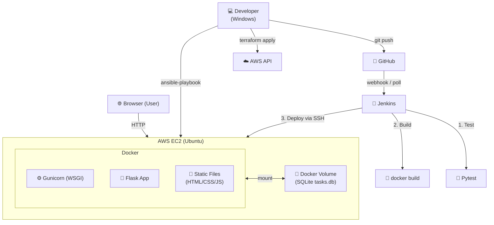

# ☁️ Cloud To-Do — Full-Stack Cloud & DevOps Project

> A functional task-management web application demonstrating **Flask**, **Docker**, **AWS EC2**, **Jenkins CI/CD**, **Terraform**, and **Ansible** — built for an academic Cloud & DevOps course.

---

## 📋 Table of Contents
1. [Project Overview](#1-project-overview)
2. [Features](#2-features)
3. [Architecture](#3-architecture)
4. [Technology Stack](#4-technology-stack)
5. [Project Structure](#5-project-structure)
6. [Prerequisites](#6-prerequisites)
7. [Run Locally (No Docker)](#7-run-locally-no-docker)
8. [Run with Docker Compose](#8-run-with-docker-compose)
9. [API Reference](#9-api-reference)
10. [Push to GitHub](#10-push-to-github)
11. [Provision AWS with Terraform](#11-provision-aws-with-terraform)
12. [Configure EC2 with Ansible](#12-configure-ec2-with-ansible)
13. [Configure Jenkins](#13-configure-jenkins)
14. [Automated Deployment Flow](#14-automated-deployment-flow)
15. [Troubleshooting](#15-troubleshooting)
16. [Stop & Clean Up](#16-stop--clean-up)
17. [Cost & Security Notes](#17-cost--security-notes)

---

## 1. Project Overview

**Cloud To-Do** is a complete, working to-do list application. It has a clean frontend, a Python Flask backend, and stores data in SQLite. The application runs inside a Docker container, is deployed to an AWS EC2 instance, and uses Jenkins to automatically build and deploy whenever you push code to GitHub.

This project demonstrates:

| Technology | Role |
|---|---|
| Flask | REST API backend |
| SQLite | Persistent task storage |
| Gunicorn | Production WSGI server |
| Docker | Container packaging |
| Docker Compose | Local orchestration |
| Git / GitHub | Version control |
| Jenkins | CI/CD pipeline |
| Terraform | AWS infrastructure provisioning |
| Ansible | EC2 server configuration |
| AWS EC2 | Cloud hosting |

---

## 2. Features

- ✅ **Create tasks** with a title and optional description
- 📋 **View all tasks** with status, date, and description
- ✔️ **Complete / reopen** tasks with a checkbox
- 🗑️ **Delete tasks** with confirmation
- 🔍 **Search** tasks by title or description
- 🔽 **Filter** by All / Pending / Completed
- 📊 **Dashboard** showing Total / Pending / Completed counts
- 🌐 **API status** indicator (real health check)
- 📱 **Responsive** design — works on mobile, tablet, and desktop
- 💾 **Persistent storage** — tasks survive container restarts

---

## 3. Architecture



---

## 4. Technology Stack

| Layer | Technology | Version |
|---|---|---|
| Language | Python | 3.12 |
| Web framework | Flask | 3.0.3 |
| WSGI server | Gunicorn | 22.0.0 |
| Database | SQLite | built-in |
| Frontend | HTML5 + CSS3 + Vanilla JS | — |
| Container | Docker | 24+ |
| Orchestration | Docker Compose | v2 plugin |
| CI/CD | Jenkins | 2.4xx LTS |
| IaC | Terraform | ≥ 1.6 |
| Config mgmt | Ansible | ≥ 2.15 |
| Cloud | AWS EC2 (Ubuntu 22.04) | t2.micro |
| Testing | Pytest | 8.2.2 |

---

## 5. Project Structure

```
cloud-project/
├── app/                        # Flask application package
│   ├── __init__.py             # Application factory
│   ├── database.py             # SQLite helpers, schema init
│   ├── routes.py               # REST API endpoints
│   └── static/
│       ├── index.html          # Single-page frontend
│       ├── style.css           # Styles
│       └── app.js              # Frontend logic (Fetch API)
│
├── tests/
│   ├── __init__.py
│   ├── conftest.py             # Pytest fixtures (temp DB)
│   └── test_api.py             # API test suite (40+ tests)
│
├── terraform/
│   ├── versions.tf             # Terraform / provider versions
│   ├── providers.tf            # AWS provider config
│   ├── variables.tf            # Input variables
│   ├── main.tf                 # Security group + EC2 instance
│   ├── outputs.tf              # IP, URL, SSH command
│   └── terraform.tfvars.example
│
├── ansible/
│   ├── setup.yml               # EC2 configuration playbook
│   └── inventory.example       # Inventory template
│
├── Dockerfile                  # Production Docker image
├── docker-compose.yml          # Local development orchestration
├── Jenkinsfile                 # CI/CD pipeline definition
├── wsgi.py                     # Gunicorn / Flask entry point
├── requirements.txt            # Python dependencies
├── .gitignore
├── .env.example
└── README.md
```

---

## 6. Prerequisites

### Windows Development Machine
| Tool | Version | Download |
|---|---|---|
| Python | 3.10+ | [python.org](https://www.python.org/downloads/) |
| Git | any | [git-scm.com](https://git-scm.com/) |
| Docker Desktop | 4.x | [docker.com](https://www.docker.com/products/docker-desktop/) |
| VS Code (optional) | any | [code.visualstudio.com](https://code.visualstudio.com/) |

### For DevOps Steps
| Tool | Installation |
|---|---|
| AWS CLI | `winget install Amazon.AWSCLI` or [aws.amazon.com](https://aws.amazon.com/cli/) |
| Terraform | [developer.hashicorp.com/terraform/downloads](https://developer.hashicorp.com/terraform/downloads) |
| Ansible | Run on WSL or a Linux VM (`pip install ansible`) |
| Jenkins | [jenkins.io/download](https://www.jenkins.io/download/) |

> **Note:** Ansible does not run natively on Windows. Use **WSL2** (Windows Subsystem for Linux) or a separate Linux machine.

---

## 7. Run Locally (No Docker)

Open **PowerShell** in the project directory:

```powershell
# 1. Create and activate a virtual environment
python -m venv venv
.\venv\Scripts\Activate.ps1

# 2. Install dependencies
pip install -r requirements.txt

# 3. Create the data directory
New-Item -ItemType Directory -Force -Path .\data

# 4. Set the database path
$env:DATABASE_PATH = ".\data\tasks.db"

# 5. Start the development server
python wsgi.py
```

Open your browser at: **http://localhost:5000**

### Run tests

```powershell
# With the virtual environment active:
pytest tests/ -v
```

---

## 8. Run with Docker Compose

Make sure **Docker Desktop** is running, then open PowerShell:

```powershell
# Build and start (foreground — shows logs)
docker compose up --build

# Build and start (background)
docker compose up --build -d

# View logs
docker compose logs -f

# Stop containers (data volume is PRESERVED)
docker compose down

# Stop AND delete the database volume
docker compose down -v
```

Open your browser at: **http://localhost:5000**

### Use a different port

```powershell
$env:HOST_PORT = "8080"
docker compose up --build -d
# App now at http://localhost:8080
```

---

## 9. API Reference

All endpoints return JSON. Base URL: `http://localhost:5000` (local) or `http://<EC2-IP>` (production).

| Method | Endpoint | Description |
|---|---|---|
| `GET` | `/api/health` | Health check |
| `GET` | `/api/tasks` | List all tasks |
| `POST` | `/api/tasks` | Create a task |
| `PATCH` | `/api/tasks/<id>` | Update a task |
| `DELETE` | `/api/tasks/<id>` | Delete a task |

### Examples (PowerShell — curl)

```powershell
# Health check
curl http://localhost:5000/api/health

# Get all tasks
curl http://localhost:5000/api/tasks

# Create a task
curl -Method POST http://localhost:5000/api/tasks `
  -ContentType "application/json" `
  -Body '{"title": "Buy milk", "description": "2 litres"}'

# Complete a task (replace 1 with real ID)
curl -Method PATCH http://localhost:5000/api/tasks/1 `
  -ContentType "application/json" `
  -Body '{"completed": true}'

# Delete a task
curl -Method DELETE http://localhost:5000/api/tasks/1
```

---

## 10. Push to GitHub

```powershell
# 1. Initialise Git in the project directory
git init
git branch -M main

# 2. Stage all files
git add .

# 3. First commit
git commit -m "Initial commit: Cloud To-Do application"

# 4. Add your GitHub repository as remote
#    (create the repo on github.com first — leave it empty)
git remote add origin https://github.com/YOUR-USERNAME/cloud-todo.git

# 5. Push
git push -u origin main
```

> **Authentication:** If prompted, use a **Personal Access Token** (PAT) as the password.  
> Create one at: GitHub → Settings → Developer Settings → Personal Access Tokens → Tokens (classic)

---

## 11. Provision AWS with Terraform

> ⚠️ **These commands provision real AWS resources that incur costs. Do not run without understanding the charges.**

### One-time setup

```powershell
# Configure AWS credentials (one of these options):
# Option A — environment variables
$env:AWS_ACCESS_KEY_ID     = "AKIA..."
$env:AWS_SECRET_ACCESS_KEY = "..."
$env:AWS_DEFAULT_REGION    = "ap-south-1"

# Option B — AWS CLI named profile
aws configure --profile my-profile
```

### Create terraform.tfvars

```powershell
Copy-Item terraform\terraform.tfvars.example terraform\terraform.tfvars
# Edit terraform\terraform.tfvars with Notepad or VS Code:
notepad terraform\terraform.tfvars
```

Fill in:
- `key_name` — name of an EC2 Key Pair you created in the AWS Console
- `ssh_allowed_cidr` — your public IP + `/32` (find it with `curl https://ifconfig.me`)

### Run Terraform

```powershell
cd terraform

# Initialise providers
terraform init

# Format and validate
terraform fmt
terraform validate

# Preview changes (read-only — safe to run)
terraform plan

# ⚠️ Apply — ONLY run this when you want to CREATE resources
terraform apply
# Type 'yes' when prompted
```

After apply, note the outputs:

```
public_ip       = "13.235.x.x"
application_url = "http://13.235.x.x:80"
ssh_command     = "ssh -i <key-file>.pem ubuntu@13.235.x.x"
```

---

## 12. Configure EC2 with Ansible

> Run Ansible from **WSL2** or a Linux machine. Not supported natively on Windows.

```bash
# 1. Copy the inventory example
cp ansible/inventory.example ansible/inventory.ini

# 2. Edit inventory.ini — replace placeholders
nano ansible/inventory.ini
# Set YOUR.EC2.PUBLIC.IP to the Terraform output public_ip
# Set the path to your .pem key file

# 3. Test connectivity
ansible ec2 -i ansible/inventory.ini -m ping

# 4. Run the setup playbook
ansible-playbook -i ansible/inventory.ini ansible/setup.yml

# Expected output: all tasks green (or yellow for 'changed'), no red failures
```

After Ansible completes, the server has Docker installed and the `/opt/cloud-todo` directory created.

---

## 13. Configure Jenkins

### Step 1 — Add credentials

Go to **Jenkins → Manage Jenkins → Credentials → System → Global credentials → Add Credential**:

| ID | Type | What to put |
|---|---|---|
| `EC2_HOST` | Secret text | Your EC2 public IP (e.g. `13.235.x.x`) |
| `EC2_SSH_KEY` | SSH Username with private key | Username: `ubuntu`; paste your `.pem` private key content |
| `GITHUB_CREDS` | Username + password | GitHub username + Personal Access Token (if private repo) |

### Step 2 — Create a Pipeline job

1. Jenkins → New Item → name it `cloud-todo` → choose **Pipeline** → OK
2. Scroll to **Pipeline** section
3. Set **Definition** = `Pipeline script from SCM`
4. Set **SCM** = `Git`
5. Enter your GitHub repository URL
6. Add `GITHUB_CREDS` if needed
7. Set **Branch Specifier** = `*/main`
8. Set **Script Path** = `Jenkinsfile`
9. **Save**

### Step 3 — Trigger (optional GitHub webhook)

In GitHub → your repo → Settings → Webhooks → Add webhook:
- **Payload URL:** `http://<jenkins-ip>:8080/github-webhook/`
- **Content type:** `application/json`
- **Events:** Just the push event

Without a webhook, Jenkins polls every 2 minutes (see `Jenkinsfile` triggers).

### Step 4 — Run the pipeline

Click **Build Now** in Jenkins to trigger the first build manually.

---

## 14. Automated Deployment Flow

```
Developer writes code
        │
        ▼
  git push to GitHub
        │
        ▼  (webhook or poll)
  Jenkins picks up change
        │
        ├─ Stage 1: Checkout code
        ├─ Stage 2: Run Pytest (fail fast if tests break)
        ├─ Stage 3: docker build (tagged with commit SHA)
        ├─ Stage 4: Readiness check
        ├─ Stage 5: SCP image to EC2 → docker compose up -d
        └─ Stage 6: curl /api/health → pass/fail
```

The **database volume** is never deleted during deployment, so existing tasks are preserved.

---

## 15. Troubleshooting

### Docker daemon not running
```
Error: Cannot connect to the Docker daemon
```
→ Open Docker Desktop. Wait for it to start (whale icon in tray).

### Port already in use
```
Bind: address already in use
```
```powershell
# Find what's using port 5000
netstat -ano | findstr :5000
# Kill it, or use a different HOST_PORT:
$env:HOST_PORT = "5001"; docker compose up -d
```

### Jenkins cannot access Docker
- Ensure Docker Desktop is running.
- The Jenkins service account must be in the **docker-users** group on Windows.
- Or run Jenkins in a Linux VM/WSL2 where the Docker socket is `/var/run/docker.sock`.

### Jenkins service account SSH key issue
- Jenkins needs to read the private key file.
- Use **Jenkins Credentials** (type: SSH Username with private key) instead of a file path.

### GitHub checkout authentication failure
- Use a Personal Access Token (PAT), not your password.
- Store it in Jenkins Credentials as `GITHUB_CREDS`.

### Terraform AWS credential errors
```
Error: No valid credential sources found
```
→ Run `aws configure` or set `AWS_ACCESS_KEY_ID` / `AWS_SECRET_ACCESS_KEY` environment variables.

### SSH connection timeout to EC2
- Check that port 22 is open in the Security Group for your IP.
- Verify the EC2 instance is running in the AWS Console.
- Make sure you are using the correct `.pem` key for the Key Pair name in Terraform.

### Incorrect Security Group rules
- Use `terraform plan` to verify rules before applying.
- Your IP must match `ssh_allowed_cidr` exactly.

### Database permission / persistence errors
```
sqlite3.OperationalError: unable to open database file
```
- The `/data` directory must be writable by the container user.
- Named volumes are managed by Docker — do not bind-mount a Windows path over `/data`.

### Deployment health check fails
- Check container logs: `docker compose logs` (on EC2 via SSH).
- Verify the Security Group allows port 80 from anywhere.
- Ensure `HOST_PORT=80` is set when running compose on EC2.

---

## 16. Stop & Clean Up

### Local
```powershell
docker compose down          # stop containers, keep data
docker compose down -v       # stop containers AND delete database
```

### EC2 (via SSH)
```bash
cd /opt/cloud-todo
docker compose down
```

### Destroy AWS resources
```powershell
cd terraform

# ⚠️ This deletes the EC2 instance and all data on it permanently.
terraform destroy
# Type 'yes' when prompted.
```

---

## 17. Cost & Security Notes

### AWS Costs
- **t2.micro** is Free Tier eligible for 750 hours/month for the first 12 months.
- After Free Tier, a t2.micro in ap-south-1 costs ~$0.012/hour (~$8.76/month).
- **Always run `terraform destroy`** when finished to avoid unexpected charges.
- Check the [AWS Cost Calculator](https://calculator.aws/) for estimates.

### Security Warnings
- This application uses **plain HTTP**. For production, add HTTPS with Let's Encrypt or an AWS ALB.
- SSH access is restricted to your IP, but **HTTP port 80 is open to the internet**.
- The SQLite database is not encrypted at rest (acceptable for an educational project).
- Do **not** commit `.env`, `terraform.tfvars`, `.pem` files, or any secrets to Git.
- This project is **not reviewed for production security** — treat it as an educational MVP.

---

*Cloud To-Do | Built with Flask, Docker, and AWS*
